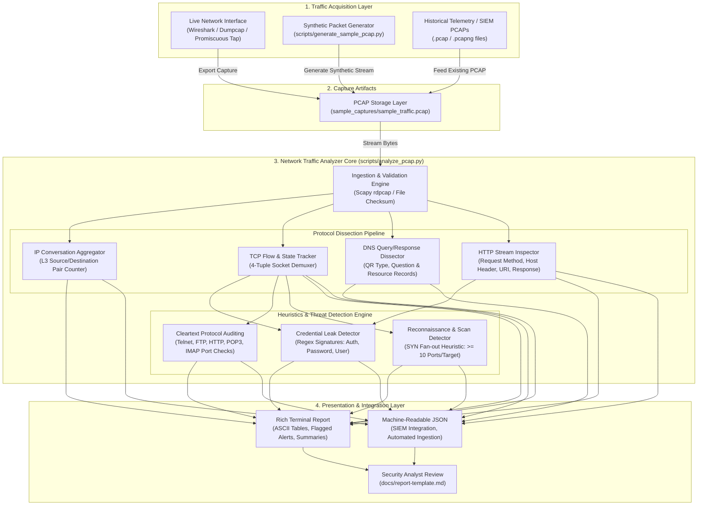
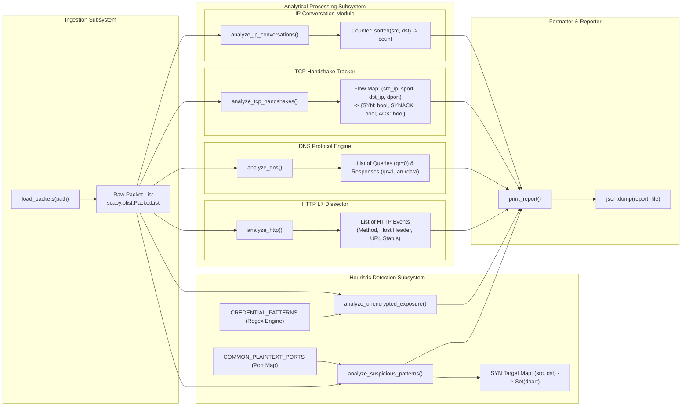
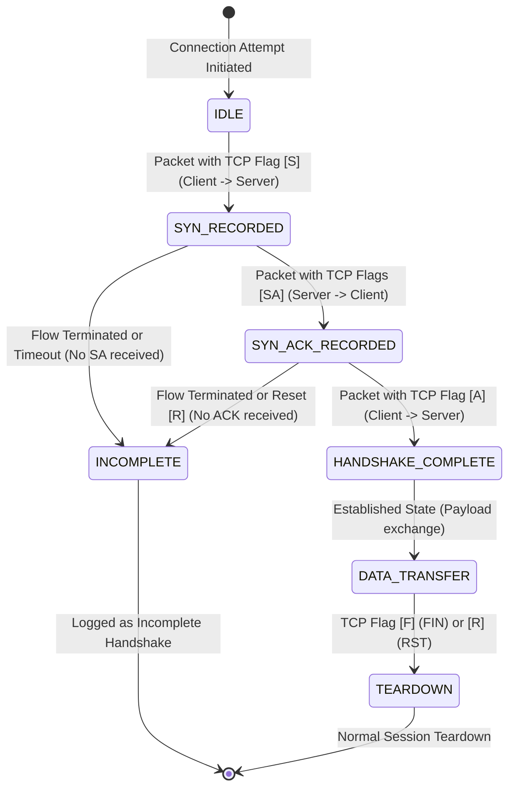
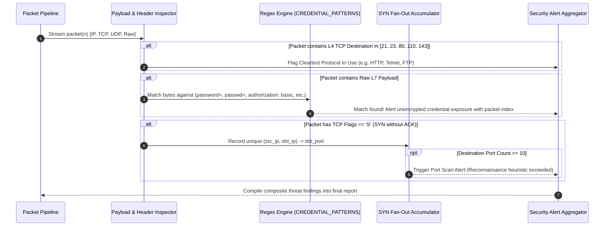

# 🛡️ Network Traffic Analyzer & Automated Packet Dissector

[](https://www.python.org/)
[](https://scapy.net/)
[](https://www.wireshark.org/)
[](#system-architecture-hld--lld)
[](LICENSE)

An end-to-end network security analytics toolkit that bridges manual packet inspection in **Wireshark** with automated, programmatic **Deep Packet Inspection (DPI)** in **Python & Scapy**. 

Engineered for SOC analysts, network engineers, and security researchers, this system ingests raw packet captures (`.pcap` / `.pcapng`), reconstructs transport-layer conversations, validates TCP state machines, extracts application-layer payloads, identifies plaintext credential exposures, and surfaces reconnaissance activities (such as SYN port scans).

---

## 📑 Table of Contents

- [Executive Overview](#-executive-overview)
- [System Architecture (HLD & LLD)](#-system-architecture-hld--lld)
  - [High-Level Design (HLD)](#high-level-design-hld)
  - [Low-Level Design (LLD)](#low-level-design-lld)
    - [Component & Subsystem Architecture](#component--subsystem-architecture)
    - [TCP 3-Way Handshake Finite State Machine (FSM)](#tcp-3-way-handshake-finite-state-machine-fsm)
    - [Security Heuristics & Anomaly Detection Pipeline](#security-heuristics--anomaly-detection-pipeline)
- [Core Capabilities](#-core-capabilities)
- [Repository Structure](#-repository-structure)
- [Getting Started](#-getting-started)
  - [Prerequisites](#prerequisites)
  - [Installation](#installation)
- [Usage Guide](#-usage-guide)
  - [1. Generate Synthetic PCAP (Zero Risk)](#1-generate-synthetic-pcap-zero-risk)
  - [2. Execute Automated Traffic Analysis](#2-execute-automated-traffic-analysis)
  - [3. Export Structured JSON Reports](#3-export-structured-json-reports)
  - [4. Capture Live Traffic via Wireshark Lab](#4-capture-live-traffic-via-wireshark-lab)
- [Sample Execution & Output](#-sample-execution--output)
  - [Console Output](#console-output)
  - [JSON Report Schema](#json-report-schema)
- [Security Heuristics & Threat Model](#-security-heuristics--threat-model)
- [Companion Documentation](#-companion-documentation)
- [Legal & Ethical Guidelines](#-legal--ethical-guidelines)
- [Future Roadmap](#-future-roadmap)
- [License](#-license)

---

## 🔭 Executive Overview

Manual packet inspection via GUI tools like Wireshark is vital for deep-dive forensic analysis, yet it does not scale when sifting through gigabytes of telemetry across distributed networks. 

This project bridges that gap by providing:
1. **Interactive Wireshark Lab Workflows**: Guided analysis for inspecting frames, decapsulating packet headers, tracking TCP sequence numbers, and filtering protocol anomalies.
2. **Automated Headless Dissection Engine**: A modular Scapy-based Python pipeline that parses PCAP files, tracks connection statefulness, checks RFC compliance, and flags suspicious indicators.
3. **Synthetic Packet Factory**: An offline packet generator that constructs valid Ethernet/IP/TCP/UDP/DNS/HTTP packets programmatically for unit testing and CI/CD demonstration without exposing private infrastructure or sensitive data.

---

## 🏛️ System Architecture (HLD & LLD)

### High-Level Design (HLD)

The High-Level Design illustrates the macro data lifecycle: from external capture sources (Wireshark live taps, `tcpdump` daemons, or the synthetic packet generator) into the **Ingestion & Decapsulation Engine**, routing through dedicated **Protocol Dissectors**, evaluating against the **Security Heuristics Core**, and ultimately rendering to human-readable console tables and machine-readable JSON artifacts.



---

### Low-Level Design (LLD)

The Low-Level Design details the functional decomposition, internal data models, state management, and algorithmic execution flow.

#### Component & Subsystem Architecture



---

#### TCP 3-Way Handshake Finite State Machine (FSM)

The TCP analysis engine tracks directional socket 4-tuples `(src_ip, src_port, dst_ip, dst_port)` to differentiate legitimate established sessions from half-open scans, dropped connections, or aborted handshakes.



---

#### Security Heuristics & Anomaly Detection Pipeline



---

## ⚡ Core Capabilities

| Capability | Mechanism | Security Value |
|---|---|---|
| **IP Conversation Demuxing** | Sorts bidirectional IP pairings and aggregates packet volumes | Pinpoints top talkers, unexpected peer-to-peer flows, and anomalous data staging. |
| **Stateful TCP Handshake Tracking** | Analyzes 4-tuple flags (`SYN` → `SYN-ACK` → `ACK`) | Identifies completed sessions versus incomplete connections or stealth SYN scanning. |
| **DNS Transaction Logging** | Extracts question names (type `qd`) and answers (`an.rdata`) | Detects suspicious domain queries, unexpected resolvers, and DNS-based C2 beacons. |
| **HTTP L7 Dissection** | Extracts verbs (`GET`, `POST`, etc.), URIs, and `Host` headers | Audits web transactions and detects unencrypted endpoints used in place of TLS. |
| **Cleartext Credential Detection** | Pattern-matches raw payloads against regex signatures | Flags credential leakage (`username=`, `password=`, `Basic Auth`) in cleartext transit. |
| **Port Scan Heuristics** | Monitors single-source SYN attempts across $\ge 10$ unique ports | Flags horizontal/vertical port sweeps and automated network reconnaissance. |
| **Synthetic PCAP Generation** | Offline generation of RFC-compliant Ethernet/IP/TCP/UDP frames | Enables risk-free CI testing and demonstration without exposing real credentials or network IPs. |
| **Multi-Format Export** | Rich console summary + structured JSON generation (`--json`) | Facilitates direct integration with SIEMs, ingestion scripts, or automated pipelines. |

---

## 📂 Repository Structure

```
network-traffic-analyzer/
├── README.md                           # Master system documentation & architecture guide
├── requirements.txt                     # Core dependencies (Scapy >= 2.5.0)
│
├── scripts/
│   ├── analyze_pcap.py                 # Core analysis engine & CLI reporting tool
│   └── generate_sample_pcap.py         # Offline RFC-compliant synthetic traffic generator
│
├── sample_captures/
│   └── sample_traffic.pcap             # Safe, pre-generated capture for validation & testing
│
├── docs/
│   ├── lab-guide.md                    # Wireshark lab walkthrough & capture guidelines
│   ├── wireshark-filters-cheatsheet.md # Curated display & capture filter cheatsheet
│   └── report-template.md              # Formal Incident / Forensic Analysis Report template
│
└── screenshots/
    └── .gitkeep                        # Storage directory for Wireshark inspection screenshots
```

---

## 🚀 Getting Started

### Prerequisites

- **Python**: Version `3.9` or higher
- **Wireshark / TShark** *(Optional, for live packet capture)*: [Download Wireshark](https://www.wireshark.org/download.html)
- **Operating System**: macOS, Linux, or Windows (WSL2 recommended for Windows)

### Installation

1. **Clone the repository:**
   ```bash
   git clone https://github.com/shubhamsharmass0001/Network-Traffic-Analyzer.git
   cd network-traffic-analyzer
   ```

2. **Initialize and activate a virtual environment:**
   ```bash
   python3 -m venv venv
   source venv/bin/activate    # On Windows: venv\Scripts\activate
   ```

3. **Install dependencies:**
   ```bash
   pip install --upgrade pip
   pip install -r requirements.txt
   ```

---

## 🛠️ Usage Guide

### 1. Generate Synthetic PCAP (Zero Risk)

To validate the analyzer without touching live network hardware, run the synthetic traffic generator. It synthesizes a complete TCP handshake, DNS resolution, and an insecure HTTP form submission offline in memory:

```bash
python scripts/generate_sample_pcap.py
```
*Output: Generates `sample_captures/sample_traffic.pcap`.*

### 2. Execute Automated Traffic Analysis

Run the primary dissector against any `.pcap` or `.pcapng` file:

```bash
python scripts/analyze_pcap.py sample_captures/sample_traffic.pcap
```

### 3. Export Structured JSON Reports

For ingestion into Elasticsearch, Splunk, or custom automation pipelines, specify the `--json` flag:

```bash
python scripts/analyze_pcap.py sample_captures/sample_traffic.pcap --json report.json
```

### 4. Capture Live Traffic via Wireshark Lab

To capture and inspect live network telemetry from your own environment:
1. Review the step-by-step instructions in **[docs/lab-guide.md](docs/lab-guide.md)**.
2. Utilize the display filter cheat sheet in **[docs/wireshark-filters-cheatsheet.md](docs/wireshark-filters-cheatsheet.md)**.
3. Export your capture as a `.pcap` and run:
   ```bash
   python scripts/analyze_pcap.py path/to/your_capture.pcap
   ```
4. Draft your incident findings using **[docs/report-template.md](docs/report-template.md)**.

---

## 📊 Sample Execution & Output

### Console Output

```text
============================================================
 NETWORK TRAFFIC ANALYSIS REPORT
============================================================
File: sample_captures/sample_traffic.pcap
Total packets: 11

--- IP CONVERSATIONS ---
192.168.1.50     <-> 93.184.216.34    |  6 packets
192.168.1.50     <-> 8.8.8.8          |  2 packets

--- TCP HANDSHAKES DETECTED ---
[1] 192.168.1.50:52344 -> 93.184.216.34:80   SYN(True) -> SYN/ACK(True) -> ACK(True)  (complete)

--- DNS ACTIVITY ---
192.168.1.50 asked for example.com
192.168.1.50 resolved example.com -> 93.184.216.34

--- HTTP TRAFFIC ---
[pkt #5] POST /login HTTP/1.1   Host: example.com   (192.168.1.50 -> 93.184.216.34)
[pkt #7] HTTP/1.1 200 OK

--- ⚠️  UNENCRYPTED DATA EXPOSURE ---
[!] Plaintext credential-like field detected in packet #5 (pattern: password\s*=)
[!] Plaintext credential-like field detected in packet #5 (pattern: username\s*=)
[!] HTTP (unencrypted) traffic on packet #5 — data is sent in cleartext, consider HTTPS instead

--- ⚠️  SUSPICIOUS PATTERN CHECKS ---
[!] Cleartext protocol in use: HTTP (port 80)
============================================================
```

### JSON Report Schema

```json
{
  "file": "sample_captures/sample_traffic.pcap",
  "total_packets": 11,
  "ip_conversations": [
    {
      "pair": ["192.168.1.50", "93.184.216.34"],
      "count": 6
    },
    {
      "pair": ["192.168.1.50", "8.8.8.8"],
      "count": 2
    }
  ],
  "tcp_handshakes": [
    {
      "client": "192.168.1.50:52344",
      "server": "93.184.216.34:80",
      "complete": true,
      "steps": {
        "SYN": true,
        "SYNACK": true,
        "ACK": true
      }
    }
  ],
  "dns_activity": [
    {
      "type": "query",
      "src": "192.168.1.50",
      "domain": "example.com"
    },
    {
      "type": "response",
      "src": "8.8.8.8",
      "domain": "example.com",
      "answers": ["93.184.216.34"]
    }
  ],
  "http_traffic": [
    {
      "packet_index": 5,
      "direction": "request",
      "summary": "POST /login HTTP/1.1",
      "host": "example.com",
      "src": "192.168.1.50",
      "dst": "93.184.216.34"
    }
  ],
  "unencrypted_exposure": [
    "Plaintext credential-like field detected in packet #5 (pattern: password\\s*=)",
    "Plaintext credential-like field detected in packet #5 (pattern: username\\s*=)",
    "HTTP (unencrypted) traffic on packet #5 — data is sent in cleartext, consider HTTPS instead"
  ],
  "suspicious_patterns": [
    "Cleartext protocol in use: HTTP (port 80)"
  ]
}
```

---

## 🔒 Security Heuristics & Threat Model

This system implements detection heuristics aligned with the **MITRE ATT&CK®** and **OWASP** frameworks:

| Threat Category | MITRE ATT&CK / OWASP | Detection Implementation |
|---|---|---|
| **Network Sniffing & Adversary-in-the-Middle** | MITRE T1040 / T1557 | Flags unencrypted transport layers (HTTP:80, Telnet:23, FTP:21, POP3:110, IMAP:143) where traffic is susceptible to passive interception. |
| **Unsecured Credentials in Transit** | MITRE T1552 / OWASP A02:2021 | Evaluates byte-level regular expressions (`password=`, `pwd=`, `authorization: basic`, `username=`) over application payloads. |
| **Network Service Scanning** | MITRE T1046 (Network Service Discovery) | Monitors client `SYN` fan-out rate across destination ports. Triggers anomaly alert if distinct port count $\ge 10$ per target host. |
| **Incomplete / Asymmetric Handshakes** | MITRE T1498 (Network Denial of Service) | Correlates bidirectional TCP sequence flags to identify orphaned `SYN` requests without corresponding `ACK` responses. |

---

## 📚 Companion Documentation

The `docs/` directory contains structured guides designed to support hands-on networking education and forensic reporting:

- **[docs/lab-guide.md](docs/lab-guide.md)**: A complete, guided walkthrough covering:
  - Network interface selection & promiscuous capture mode configuration
  - Generating isolated test traffic via `curl`, `dig`, and web browsers
  - Dissecting DNS lookup packets, TCP handshakes, and HTTP sessions in Wireshark
  - Exporting targeted frames and filtering packet streams
- **[docs/wireshark-filters-cheatsheet.md](docs/wireshark-filters-cheatsheet.md)**: Production-ready reference for:
  - Protocol filters (`ip.addr`, `tcp.port`, `dns`, `http`, `tls.handshake`)
  - Logical operators (`&&`, `||`, `!`) and slice syntax
  - Troubleshooting filters (retransmissions, zero window, resets)
- **[docs/report-template.md](docs/report-template.md)**: Standardized report template for documenting capture methodology, key findings, packet metrics, and remediation proposals.

---

## ⚖️ Legal & Ethical Guidelines

> [!IMPORTANT]
> **Controlled Lab Environments Only**
>
> Packet sniffing and network traffic analysis must be conducted strictly within authorized environments.
>
> - **Authorization Required**: Only capture traffic on local loopbacks, private virtual labs, or networks where you possess explicit, written permission from the network owner.
> - **Sensitive Telemetry Handling**: Never commit captures containing real passwords, session tokens, private PII, or internal corporate IP addresses to public version control repositories.
> - **Compliance**: Adhere to relevant local and international computer misuse, electronic communications privacy, and wiretapping statutes (e.g., Computer Fraud and Abuse Act, GDPR, UK Computer Misuse Act).

---

## 🗺️ Future Roadmap

- [ ] **PCAP-NG Live Interface Sniffing**: Integrate live socket capture mode using Scapy's `AsyncSniffer`.
- [ ] **TLS Server Name Indication (SNI) Extraction**: Parse TLS ClientHello records to identify encrypted HTTPS destinations without decryption.
- [ ] **Automated Anomaly Scoring**: Calculate statistical entropy on payload data to detect encrypted C2 tunneling or DNS exfiltration.
- [ ] **CSV / CEF Export Formats**: Expand reporting options to Common Event Format (CEF) and CSV for direct SIEM ingestion.

---

## 📄 License

This project is licensed under the [MIT License](LICENSE) — free for educational, personal, and professional portfolio use.
